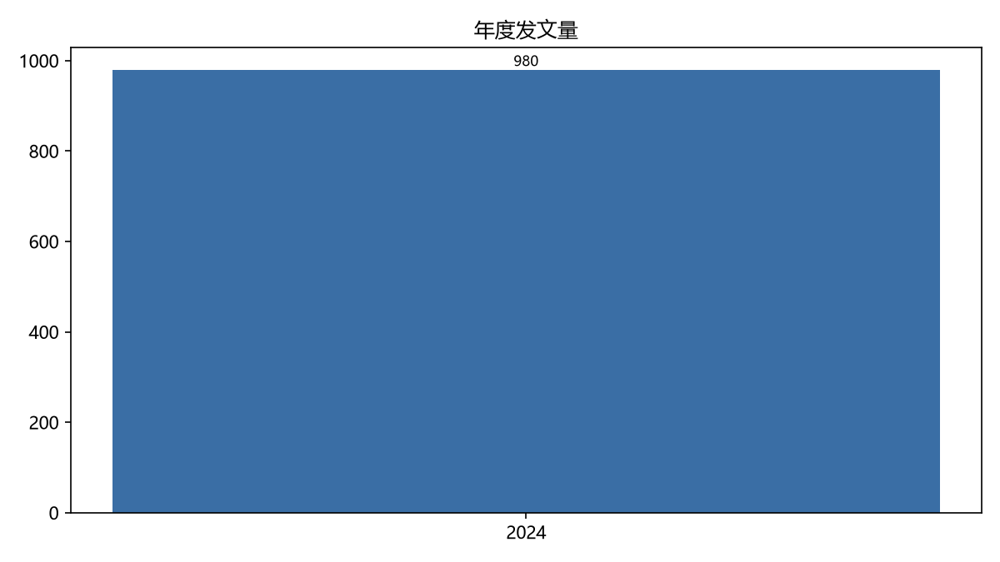
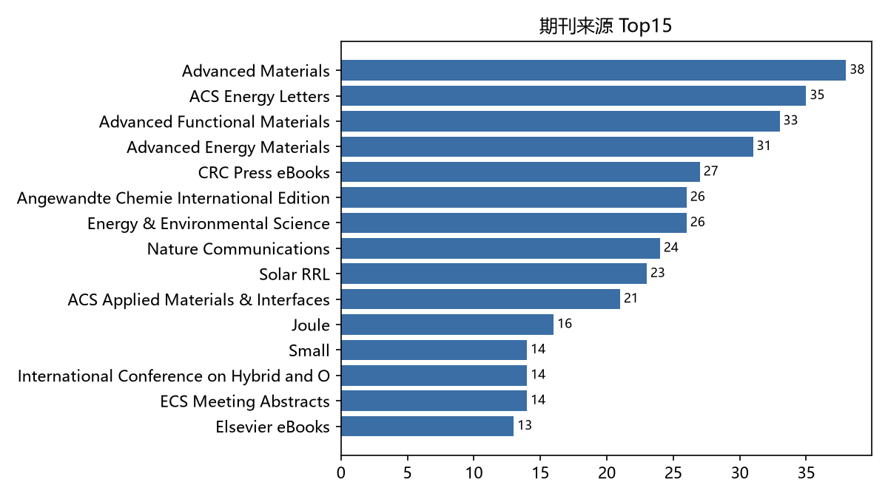
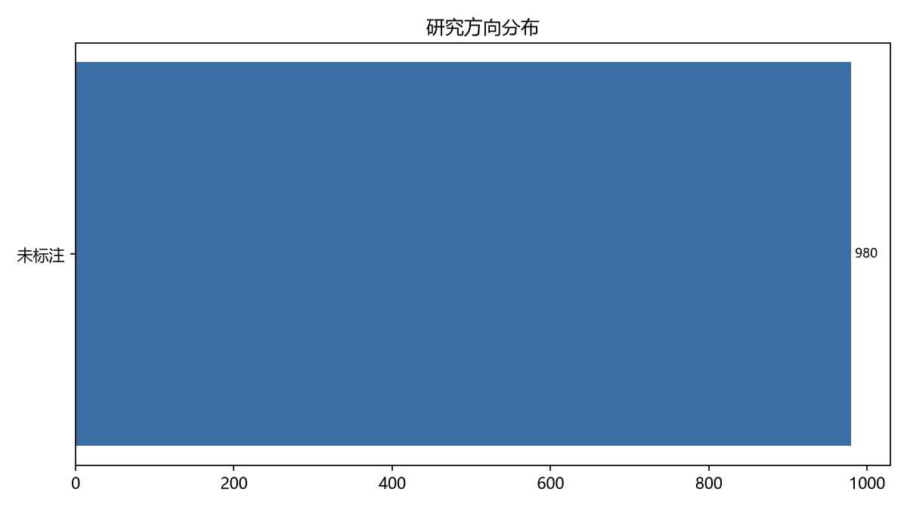
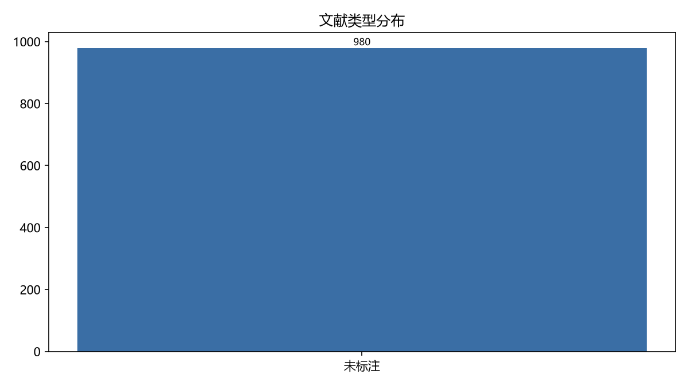
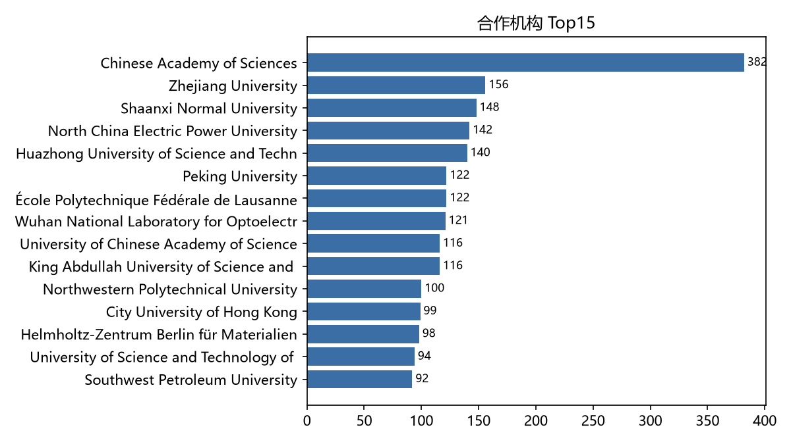

# 2024 年钙钛矿太阳能电池文献分析(展示)

- 记录总数: 980
- 纳入分析: 980

## 一、年度分布

| 年份 | 篇数 |
|---|---|
| 2024 | 980 |

## 二、期刊来源 Top15

| 期刊 | 篇数 |
|---|---|
| Advanced Materials | 38 |
| ACS Energy Letters | 35 |
| Advanced Functional Materials | 33 |
| Advanced Energy Materials | 31 |
| CRC Press eBooks | 27 |
| Angewandte Chemie International Edition | 26 |
| Energy & Environmental Science | 26 |
| Nature Communications | 24 |
| Solar RRL | 23 |
| ACS Applied Materials & Interfaces | 21 |
| Joule | 16 |
| Small | 14 |
| International Conference on Hybrid and Organic Photovoltaics (HOPV) | 14 |
| ECS Meeting Abstracts | 14 |
| Elsevier eBooks | 13 |

## 三、研究方向

| 方向 | 篇数 |
|---|---|
| 未标注 | 980 |

## 四、高被引 Top10

| 标题 | 年份 | 被引 |
|---|---|---|
| Improved charge extraction in inverted perovskite solar cells with dua | 2024 | 1387 |
| Buried interface molecular hybrid for inverted perovskite solar cells | 2024 | 1088 |
| Highly efficient and stable perovskite solar cells via a multifunction | 2024 | 732 |
| Reinforcing self-assembly of hole transport molecules for stable inver | 2024 | 586 |
| Double-side 2D/3D heterojunctions for inverted perovskite solar cells | 2024 | 452 |
| Rapid advances enabling high-performance inverted perovskite solar cel | 2024 | 408 |
| Amidination of ligands for chemical and field-effect passivation stabi | 2024 | 388 |
| Achievements, challenges, and future prospects for industrialization o | 2024 | 387 |
| Band gap tuning of perovskite solar cells for enhancing the efficiency | 2024 | 349 |
| Co‐Self‐Assembled Monolayers Modified NiO x for Stable Inverted Perovs | 2024 | 339 |

## 附图

